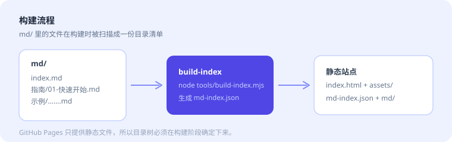

# 阅读模式示例

这一页展示正文区域的排版效果，同时可以作为「你写了一篇很长的文档」时的参考。

## 段落与强调

中文排版最怕的是行距太挤、段距太小。本站正文行高 1.75，段间距 1.15em，在 1440px 宽的屏幕上单行约 40 个汉字，是比较舒服的阅读宽度。

**加粗**用来强调结论，*斜体*用来引入新术语，`行内代码` 用来标记变量名或命令。混合使用的时候要注意克制：一段里出现三种以上的强调，等于没有强调。

## 代码

```typescript
interface DocNode {
  type: 'dir' | 'file';
  name: string;
  path: string;
  children?: DocNode[];
}

// 把扁平的文件列表还原成树
export function buildTree(files: string[]): DocNode[] {
  const root: DocNode = { type: 'dir', name: '', path: '', children: [] };
  for (const file of files) {
    const parts = file.split('/');
    let cursor = root;
    for (const part of parts.slice(0, -1)) {
      let next = cursor.children!.find((n) => n.name === part);
      if (!next) {
        next = { type: 'dir', name: part, path: '', children: [] };
        cursor.children!.push(next);
      }
      cursor = next;
    }
    cursor.children!.push({ type: 'file', name: parts.at(-1)!, path: file });
  }
  return root.children!;
}
```

## 引用与提示

> 好的文档不是写出来的，是改出来的。
>
> 每次改完，都问自己一句：第一次读的人能看懂吗？

## 长列表

1. **先写骨架**：只列标题，确认结构讲得通；
2. **再填内容**：每个标题下写三段以内；
3. **最后删减**：删掉 20% 的字，通常文档会更好；
4. **补充例子**：抽象的描述配一个具体例子；
5. **标注前提**：写清适用范围、版本、边界条件。

## 图片

下图的相对路径是 `./附件/示意图.svg`，从当前文档出发解析：



## 表格

| 功能 | 触发方式 | 说明 |
| --- | --- | :---: |
| 大纲高亮 | 自动 | 右侧大纲跟随滚动位置高亮当前章节 |
| 章节锚点 | 悬停标题后点链接图标 | 顺手把这一节的深链接复制到剪贴板 |
| 图片放大 | 点击正文里的图片 | 全屏查看，点任意处关闭 |
| 复制代码 | 点击代码块右上角「复制」 | 只复制代码本身，不含行号 |
| 上一篇 / 下一篇 | 页面底部 | 按左侧目录树的顺序生成 |

## 结尾

滚动到页面底部，会看到「上一篇 / 下一篇」链接，它们按左侧目录树的顺序生成。
